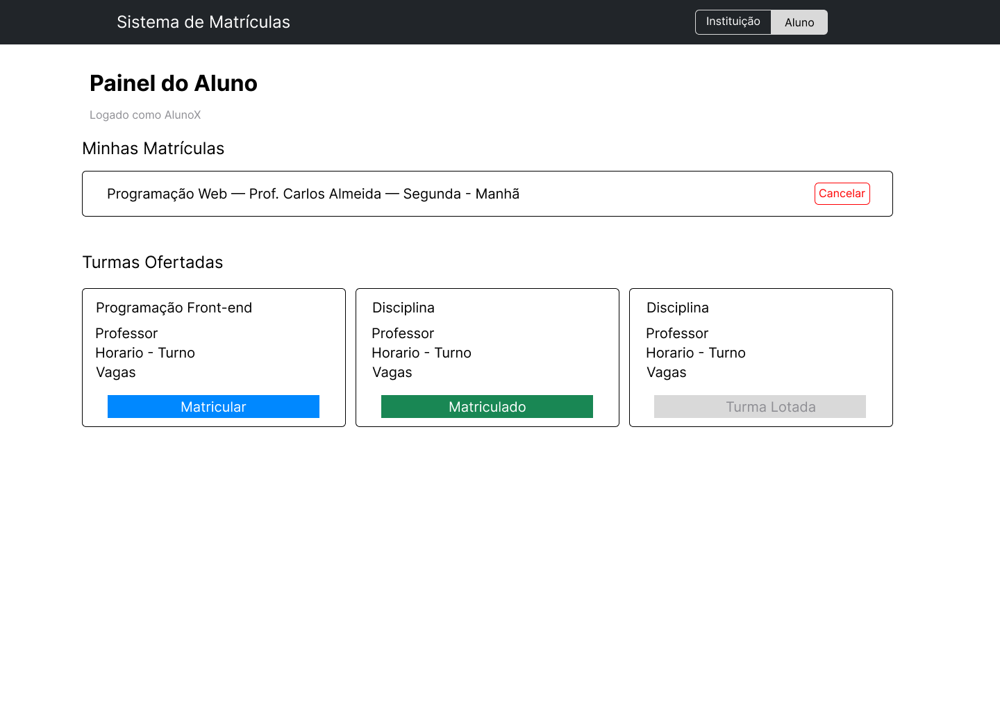
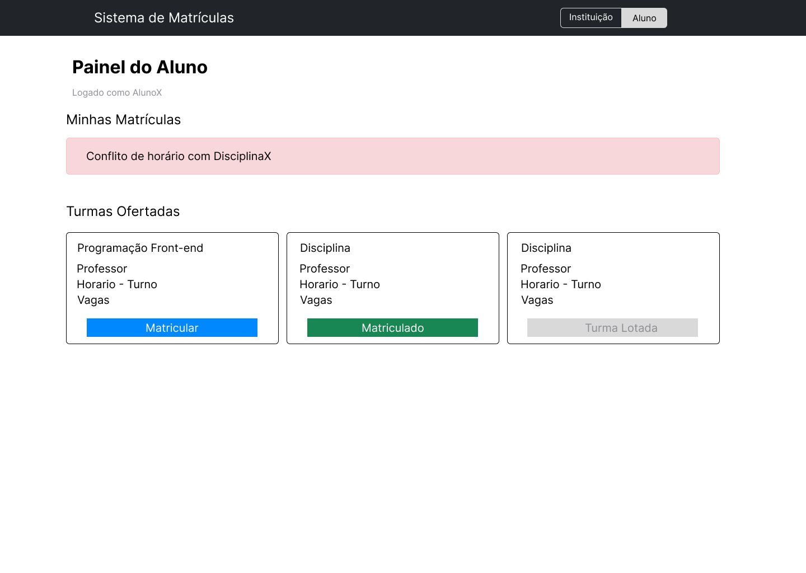
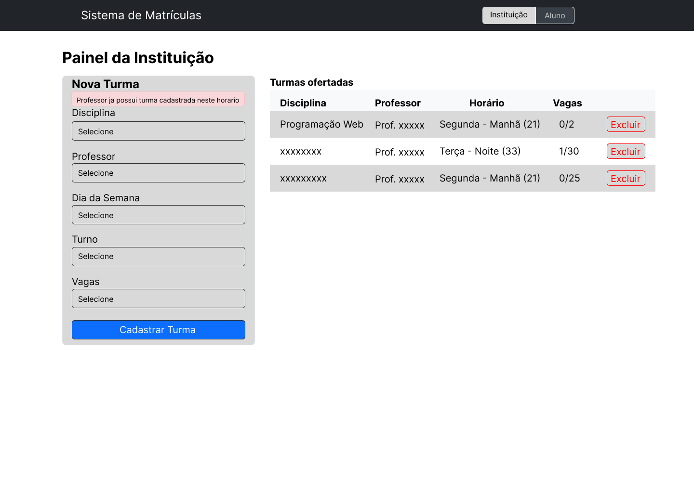

# Protótipo

Link do Figma: https://www.figma.com/design/UHM7qg0DMpqCKMZeekzLlh/Sistema-de-Matr%C3%ADculas---Prot%C3%B3tipo?node-id=4-301&t=XEHJdXb0QukDFMVu-0

## Casos de uso
1. Instituição cadastra turma
2. Instituição lista e exclui turmas
3. Aluno visualiza turmas e se matricula
4. Aluno visualiza e cancela matrículas

## Modelo de dados
- disciplinas (id, nome)
- professores (id, nome)
- alunos (id, nome)
- turmas (id, disciplinaId, professorId, horario, vagas)
- matriculas (id, alunoId, turmaId)

## Telas

